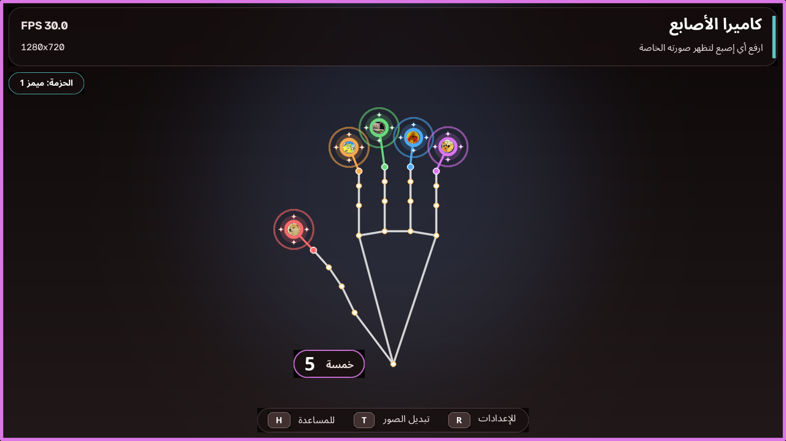
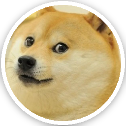
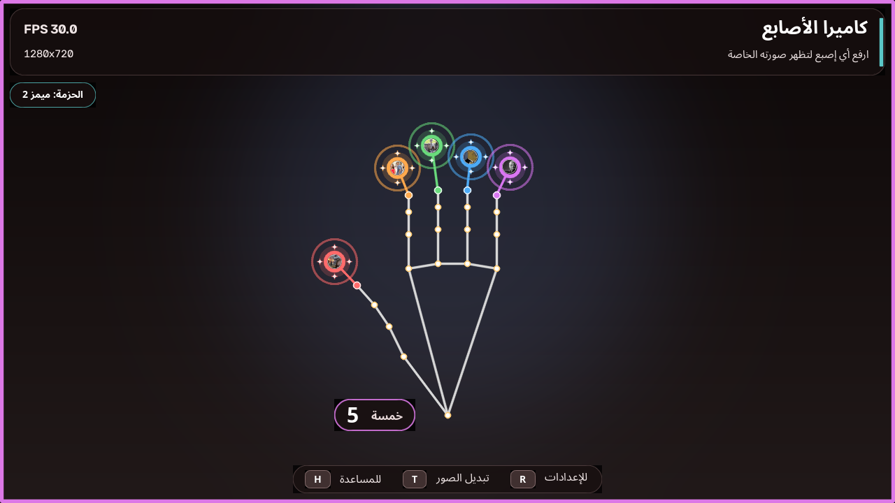
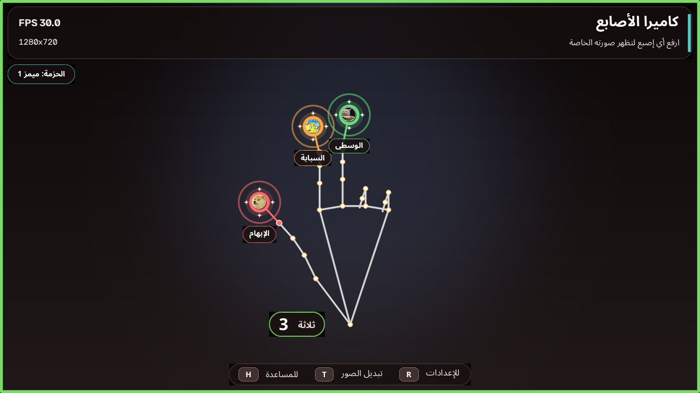
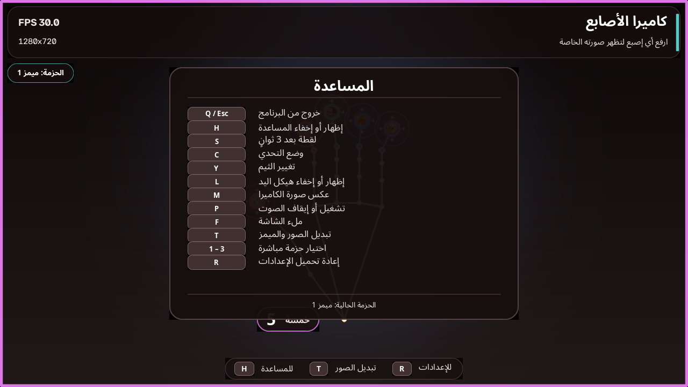

# FingerCam — كاميرا الأصابع 👋

ارفع أي إصبع أمام الكاميرا، وستظهر **صورة ميمز أو إيموجي خاصة به** فوق الإصبع مباشرة.
التطبيق يعمل محليًا على جهازك، والواجهة عربية بالكامل.

<p align="center">
  
</p>

  

---

## ✨ المميزات

- كشف **كل إصبع على حدة**: الإبهام، السبابة، الوسطى، البنصر، الخنصر.
- **صورة ميمز أو إيموجي مخصص لكل إصبع**، تظهر فوق الإصبع المرفوع.
- **3 حزم جاهزة** (ميمز 1، ميمز 2، إيموجي) وبدّلها فورًا بزر **T** أو **1/2/3**.
- دعم **يدين في نفس الوقت** (حتى 10 أصابع).
- فقاعات ملونة، خطوط ربط، حركة ظهور، وعدّاد صغير بجانب كل يد.
- واجهة عربية: عنوان، تعليمات، مساعدة، وعدّاد بالأرقام العربية.
- **ملف إعدادات بسيط** (`config.json`) لتغيير الصور/الميمز أو الإيموجي.
- إعادة تحميل الإعدادات فورًا بزر **R** دون إعادة تشغيل.
- لقطة شاشة، ملء الشاشة، هيكل اليد، المرآة، وصوت اختياري.
- اختصار **Ctrl + Win + O** لتشغيل التطبيق على Hyprland.
- يعمل بدون إنترنت بعد تثبيت المكتبات (الموديل مرفق مع المشروع).

---

## 💻 المتطلبات

- **Windows 10/11** أو **Arch Linux** (أو توزيعة Linux حديثة).
- **Windows:** Python 3.10 – 3.12 (يُفضّل **3.12**).
- **Arch:** Python 3.13+ (تم اختبار المشروع على **3.14.8**)، مع OpenCV وMediaPipe من النظام أو من `requirements.txt`.
- كاميرا ويب (داخلية أو USB).
- اتصال بالإنترنت **مرة واحدة** أثناء التثبيت لتنزيل المكتبات. الموديل موجود مسبقًا في `models/`.

> **Windows:** إذا لم يكن Python مثبتًا: نزّله من
> <https://www.python.org/downloads/windows/>
> وأثناء التثبيت فعّل خيار **Add python.exe to PATH**.

> **Arch:** لا تحتاج إلى تنزيل Python من الموقع؛ استخدم `python` من المستودعات.

---

## 🐧 التثبيت على Arch Linux

افتح Terminal داخل مجلد المشروع ثم:

```bash
cd ~/fingercam
chmod +x install.sh run.sh launch.sh
./install.sh
./run.sh
```

ماذا يفعل `install.sh`؟

1. ينشئ بيئة `.venv` مع `--system-site-packages`، أي أنها **تستخدم OpenCV وMediaPipe المثبتين في النظام** إن وجدا.
2. يثبت `arabic-reshaper` و`python-bidi` داخل البيئة (لدعم النص العربي).
3. إذا لم يجد المكتبات الثقيلة، يثبت `requirements.txt` كاملة.

### تثبيت متطلبات النظام (إذا لزم)

```bash
sudo pacman -S python python-pip
# اختياري: OpenCV وNumPy من المستودعات
sudo pacman -S python-opencv python-numpy
# MediaPipe غالبًا يُثبّت عبر pip داخل البيئة
```

> **مهم:** لا تشغّل `app.py` بـ Python 3.12 من pyenv إذا لم تكن المكتبات مثبتة فيه.
> استخدم `./run.sh` دائمًا. رسالة `Missing Python package: opencv-python` تعني أنك استخدمت Python آخر.

### تشغيل سريع بدون سكربت

```bash
QT_QPA_PLATFORM=xcb .venv/bin/python app.py
```

> على Wayland/Hyprland، OpenCV يحتاج `QT_QPA_PLATFORM=xcb` (سكربتات `run.sh` و`launch.sh` تضبطه تلقائيًا).

### ملاحظات Arch

- شغّل التطبيق من **جلسة سطح المكتب** (ليس SSH فقط)، وتأكد أن `echo $DISPLAY` يطبع قيمة مثل `:0` أو `:1`.
- **لا تشغّله بـ `sudo`**؛ قد ترفض خدمة X الاتصال.
- إذا لم تفتح النافذة، جرّب:
  ```bash
  ./run.sh --camera 0 --width 1280 --height 720
  ```
- إذا كانت الكاميرا محمية، أضف مستخدمك لمجموعة `video` ثم أعد تسجيل الدخول:
  ```bash
  sudo usermod -aG video "$USER"
  ```

### اختصار Hyprland: Ctrl + Win + O

على هذا الجهاز، الاختصار مضاف بالفعل في `~/.config/hypr/hyprland.conf`:

```ini
bind = $mainMod CTRL, O, exec, /home/whoami/fingercam/launch.sh
```

- اضغط **Ctrl + Win + O** من أي مكان لفتح FingerCam.
- `launch.sh` يشغّل التطبيق، يسجّل الأخطاء في `fingercam.log`، ويمنع فتح نسختين في نفس الوقت.
- أضفت أيضًا اختصارًا في قائمة التطبيقات: `~/.local/share/applications/fingercam.desktop`.
- بعد أي تعديل على إعدادات Hyprland شغّل:
  ```bash
  hyprctl reload
  ```
- إذا نقلت المشروع إلى مسار آخر، عدّل مسار `launch.sh` في سطر `bind`.

> على أي توزيعة/واجهة أخرى، اربط الاختصار بالأمر:
> ```bash
> /path/to/fingercam/launch.sh
> ```

---

## 🚀 التثبيت على ويندوز

1. ضع مجلد المشروع في مكان تكتب فيه (مثل `Desktop` أو `Documents`). تجنّب `Program Files`.
2. اضغط **دبل كليك** على `install.bat`.
3. انتظر حتى تنتهي رسالة:
   ```
   Installation finished successfully!
   ```
4. اضغط دبل كليك على `run.bat` لتشغيل التطبيق.

> إن ظهرت نافذة SmartScreen: اضغط **More info** ثم **Run anyway**.
> أول تشغيل قد يستغرق بضع ثوانٍ لتحميل الموديل.

### التثبيت اليدوي (اختياري)

```bat
py -3.12 -m venv .venv
.venv\Scripts\python.exe -m pip install --upgrade pip
.venv\Scripts\python.exe -m pip install -r requirements.txt
.venv\Scripts\python.exe app.py
```

---

## 🎮 التشغيل والتحكم

شغّل `run.bat` على ويندوز، أو `./run.sh` على Arch، أو اضغط **Ctrl + Win + O** على Hyprland.
ثم ارفع يدك أمام الكاميرا. التطبيق يبقى مفتوحًا حتى تضغط **Q** أو **Esc**.

| الزر | الوظيفة |
|------|---------|
| **Q** أو **Esc** | خروج |
| **H** | إظهار / إخفاء المساعدة |
| **S** | حفظ لقطة في مجلد `snapshots/` |
| **L** | إظهار / إخفاء هيكل اليد |
| **M** | عكس صورة الكاميرا (المرآة) |
| **P** | تشغيل / إيقاف الصوت |
| **F** | ملء الشاشة |
| **T** | الحزمة التالية (صور/ميمز) |
| **Shift + T** | الحزمة السابقة |
| **1 / 2 / 3** | اختيار حزمة مباشرة |
| **R** | إعادة تحميل `config.json` |

> **اختصار خارجي:** على Hyprland، اضغط **Ctrl + Win + O** لفتح التطبيق من أي مكان.

### الصور الافتراضية لكل إصبع

| الإصبع | الصورة الافتراضية | الميم | الإيموجي الاحتياطي | اللون |
|--------|-------------------|-------|-------------------|-------|
| الإبهام |  | Doge | 👍 | أحمر |
| السبابة |  | Mocking SpongeBob | ☝️ | برتقالي |
| الوسطى |  | Smudge the Cat | 🤟 | أخضر |
| البنصر |  | Drake | 💍 | أزرق |
| الخنصر |  | This Is Fine | 🤘 | بنفسجي |

> الصور الافتراضية هي **ميمز دائرية** بإطار أبيض وظل، موجودة في `assets/`. يمكنك استبدالها بأي صورة ميمز أخرى.
> الإيموجي الاحتياطي يظهر تلقائيًا إذا لم تُعثر على الصورة.
> الميمز هنا لأغراض الفكاهة/التعليم؛ استبدلها بصورك الخاصة إن أردت.

> الصورة/الإيموجي يظهر فقط عندما يكون الإصبع مرفوعًا وواضحًا. افرد إصبعك جيدًا وأبقِ يدك داخل الإطار.

### حزم الصور الجاهزة

| الحزمة | الصور |
|--------|-------|
| **ميمز 1** | Doge، Mocking SpongeBob، Smudge the Cat، Drake، This Is Fine |
| **ميمز 2** | Disaster Girl، Distracted Boyfriend، Waiting Skeleton، Tuxedo Pooh، Absolute Cinema |
| **إيموجي** | 👍 ☝️ 🤟 💍 🤘 |

| ميمز 2 | إيموجي |
|--------|--------|
|  |  |

> بدّل الحزمة داخل التطبيق بزر **T** (أو **Shift+T** للرجوع)، أو **1/2/3** مباشرة.
> اسم الحزمة الحالية يظهر أعلى يسار الشاشة، وتقدر تغيّرها من `config.json`.

### معاينات إضافية

| ثلاثة أصابع + أسماء | شاشة المساعدة |
|---------------------|----------------|
|  |  |

---

## 🎨 تخصيص الصور والميمز والإيموجي

كل شيء من ملف **`config.json`** الموجود بجانب `app.py`.
افتحه بـ **Notepad** أو أي محرر نصوص، عدّل، احفظ، ثم اضغط **R** داخل التطبيق.

### 1) الحزم والصور أو الإيموجي

التطبيق يستخدم قائمة **`sticker_packs`**: كل حزمة لها اسم وخمس صور/إيموجي. الحزم الثلاث موجودة في `config.json`:

```json
"sticker_packs": [
  { "name": "ميمز 1", "stickers": { "thumb": "assets/thumb.png" } },
  { "name": "ميمز 2", "stickers": { "thumb": "assets/memes2/thumb.png" } },
  { "name": "إيموجي", "stickers": { "thumb": "assets/emoji/thumb.png" } }
],
"active_pack": 0
```

كل حزمة تحتوي المفاتيح الخمسة: `thumb`، `index`، `middle`، `ring`، `pinky`.
هذا مثال مختصر؛ الملف الفعلي يحتوي المسارات الخمسة كاملة لكل حزمة.

- `active_pack` هو رقم الحزمة التي تبدأ عند التشغيل (0 = الأولى).
- داخل التطبيق: **T** للحزمة التالية، **Shift+T** للسابقة، و**1/2/3** لاختيار حزمة مباشرة.
- لتغيير صورة داخل حزمة، عدّل قيم `stickers` فيها. يمكنك وضع مسار صورة أو إيموجي مباشرة:

```json
"stickers": {
  "thumb": "👍",
  "index": "assets/star.png",
  "middle": "🤟",
  "ring": "💍",
  "pinky": "assets/pinky.png"
}
```

- `finger_emojis` ما زال موجودًا كخيار احتياطي: يُستخدم إذا كانت الحزمة ناقصة أو إذا حذفت `sticker_packs`.

### 2) إضافة صورة جديدة

ضع الصورة داخل مجلد `assets/` (يفضّل PNG مربعة بخلفية شفافة)، ثم اكتب مسارها داخل `stickers` في الحزمة التي تريدها:

```json
"stickers": {
  "index": "assets/star.png"
}
```

- الصيغ المدعومة: **PNG، JPG، JPEG، WebP، BMP، GIF** (أول إطار).
- يمكن استخدام مسار مطلق أيضًا، مثل `"C:/Users/Me/Pictures/star.png"` أو `"/home/me/star.png"`.
- إذا لم يُعثر على الصورة، يطبع التطبيق تحذيرًا في الكونسول ويستخدم الإيموجي الاحتياطي.
- الصورة تُكبّر/تُصغّر تلقائيًا لتناسب الفقاعة.

### 3) إضافة حزمة ميمز جديدة

أضف كائنًا جديدًا إلى قائمة `sticker_packs`:

```json
{
  "name": "ميمز 3",
  "stickers": {
    "thumb": "assets/meme3/thumb.png",
    "index": "assets/meme3/index.png",
    "middle": "assets/meme3/middle.png",
    "ring": "assets/meme3/ring.png",
    "pinky": "assets/meme3/pinky.png"
  }
}
```

ثم احفظ واضغط **R**، واخترها بزرها (إذا كانت الحزمة الرابعة اضغط **4**، أو تنقّل بـ **T**).

- يفضّل صورة **مربعة** أو قريبة من المربع.
- التطبيق يكبّر/يصغّر الصورة تلقائيًا لتناسب الفقاعة.
- يمكنك خلط الميمز مع الإيموجي في نفس الحزمة.
- الحزمة الأولى (ميمز 1) موجودة أيضًا في `finger_emojis` كاحتياط.

### 4) تغيير الألوان والحجم

```json
"finger_colors": {
  "thumb": "#FF6B6B",
  "index": "#FFA94D",
  "middle": "#69DB7C",
  "ring": "#4DABF7",
  "pinky": "#DA77F2"
},
"sticker_size": 92,
"show_labels": true,
"show_count": true,
"show_skeleton": true,
"mirror": true,
"sound": false
```

| الإعداد | المعنى |
|---------|--------|
| `active_pack` | رقم الحزمة عند بدء التشغيل (0 = الأولى) |
| `sticker_size` | قطر فقاعة الصورة/الإيموجي (40 – 120) |
| `show_labels` | إظهار اسم الإصبع تحت الفقاعة (عند رفع 1–3 أصابع) |
| `show_count` | إظهار عدّاد الأصابع بجانب اليد |
| `show_skeleton` | إظهار هيكل اليد |
| `mirror` | عكس صورة الكاميرا |
| `sound` | صوت عند تغيّر عدد الأصابع |

### 5) إعادة الإعدادات الافتراضية

احذف `config.json` وأعد تشغيل التطبيق؛ سيُنشئ ملفًا جديدًا بالإعدادات الافتراضية.

> **ملاحظة:** ملف `config.json` يجب أن يبقى بصيغة JSON صحيحة (أقواس، فواصل، علامات اقتباس).
> إذا كان فيه خطأ، سيستخدم التطبيق الإعدادات الافتراضية ويظهر لك تنبيه.

---

## 🧠 كيف يعمل؟

1. **MediaPipe Hand Landmarker** (Tasks API) يكتشف 21 نقطة لكل يد.
2. يحوّل التطبيق الإحداثيات من نسبية إلى بكسلات مع تصحيح اختلاف العرض والارتفاع.
3. **الإصبع مرفوع** إذا:
   - زاوية المفصل الأوسط (PIP) أكبر من 150°، **و**
   - طرف الإصبع أبعد عن الرسغ من المفصل الأوسط بمقدار 1.10 مرة على الأقل.
4. **الإبهام مرفوع** إذا:
   - زاوية مفصل IP أكبر من 140°، **و**
   - طرف الإبهام أبعد عن مفصل الخنصر من مفصل الإبهام بمقدار 1.02 مرة على الأقل.
5. كل إصبع مرفوع يحصل على فقاعته الخاصة، وتُبعد الفقاعات عن بعضها تلقائيًا لتجنب التداخل.
6. النص العربي يُرسم بواسطة **Pillow + Raqm** (أو `arabic-reshaper` + `python-bidi` كبديل).
7. الحزم (`sticker_packs`) تُقرأ من `config.json` وتُبنى مرة واحدة؛ زر **T** يبدّل الحزمة فورًا، والصور المفقودة تستخدم الإيموجي الاحتياطي.

هذه القواعد هندسية بسيطة، لذلك الإضاءة وتغطية اليد تؤثر على الدقة.

---

## 🧪 اختبار المنطق بدون كاميرا

**Windows:**
```bat
.venv\Scripts\python.exe test_hand_logic.py
```

**Arch / Linux:**
```bash
.venv/bin/python test_hand_logic.py
```

يشغّل 11 اختبارًا للعدّ الهندسي (بما فيها الدوران 0°/30°/90°/180°/270°) دون الحاجة إلى كاميرا.

---

## 🛠️ حل المشاكل

### التطبيق يفتح ويغلق فورًا

- التطبيق **يبقى مفتوحًا** حتى تضغط **Q** أو **Esc**؛ الإغلاق الفوري يعني وجود خطأ في الطرفية.
- اقرأ آخر سطر في الطرفية. أشهر سبب:
  ```
  [FingerCam] Missing Python package: opencv-python
  ```
  أي أنك شغّلت `app.py` بـ Python لا يحتوي المكتبات (مثل Python 3.12 من pyenv).
- **الحل على Arch:** استخدم `./run.sh` أو `.venv/bin/python app.py`.
- **الحل على Windows:** استخدم `run.bat` أو `.venv\Scripts\python.exe app.py`.
- لا تغلق نافذة الطرفية أثناء عمل التطبيق؛ إغلاقها يوقف التطبيق.

### `Missing Python package: opencv-python` أو `No module named ...`

- أنت تستخدم Python مختلفًا عن بيئة المشروع.
- على Arch:
  ```bash
  cd ~/fingercam
  ./run.sh
  ```
- على Windows:
  ```bat
  run.bat
  ```
- لا تستخدم `/home/whoami/.pyenv/versions/3.12.14/bin/python` إلا إذا ثبّتت المكتبات داخله.

### `Authorization required, but no authorization protocol specified`

- أنت تشغّل التطبيق بـ `sudo` أو من مستخدم آخر.
- شغّله بمستخدم سطح المكتب العادي، وتأكد أن `DISPLAY` مضبوط:
  ```bash
  echo $DISPLAY
  ./run.sh
  ```

### الكاميرا لا تفتح

- أغلق Zoom / Teams / المتصفحات التي قد تستخدم الكاميرا.
- **Windows:** Settings → Privacy & security → Camera → فعّل:
  - Camera access
  - Let desktop apps access your camera
- **Arch:** تأكد أن المستخدم ضمن مجموعة `video`:
  ```bash
  sudo usermod -aG video "$USER"
  ```
  ثم أعد تسجيل الدخول.
- جرّب كاميرا أخرى:
  ```bash
  ./run.sh --camera 1
  ```
- إذا كانت الكاميرا خارجية، افصلها وأعد توصيلها.

### `Python was not found`

- ثبّت Python 3.12 (64-bit) من python.org.
- أثناء التثبيت فعّل **Add python.exe to PATH**.
- أعد تشغيل `install.bat`.

### فشل تثبيت `mediapipe`

- **Windows:** استخدم **Python 3.11 أو 3.12 (64-bit)**.
- **Arch:** استخدم `./install.sh` أولًا؛ إذا فشل، جرّب:
  ```bash
  .venv/bin/python -m pip install --upgrade pip
  .venv/bin/python -m pip install mediapipe
  ```
- احذف مجلد `.venv` ثم أعد التثبيت إذا استمر الخطأ.

### النص العربي مقطّع أو معكوس

- **Arch:** شغّل `./install.sh` مرة أخرى (يثبّت `arabic-reshaper` و`python-bidi`).
- **Windows:** شغّل `install.bat` مرة أخرى.
- معظم إصدارات Pillow الحديثة تدعم العربية مباشرة عبر Raqm.

### فشل تنزيل الموديل

نزّل الملف يدويًا من:

```
https://storage.googleapis.com/mediapipe-models/hand_landmarker/hand_landmarker/float16/1/hand_landmarker.task
```

وضعه في:

```
models/hand_landmarker.task
```

### التطبيق بطيء

- جرّب دقة أقل:
  **Windows:**
  ```bat
  run.bat --width 640 --height 480
  ```
  **Arch:**
  ```bash
  ./run.sh --width 640 --height 480
  ```
- أغلق البرامج الثقيلة.
- حسّن الإضاءة وأبقِ اليد قريبة من الكاميرا.

### الإصبع أو صورته لا تظهر

- افرد الإصبع بوضوح.
- أبقِ اليد كاملة داخل الإطار.
- تأكد من أن الإصبع غير مغطى.
- جرّب إضاءة أفضل.

### الصورة المخصصة لا تظهر

- تأكد من أن الحزمة الصحيحة مختارة (الاسم أعلى يسار الشاشة).
- تأكد من صحة المسار داخل `stickers` في الحزمة، وليس في مكان آخر.
- استخدم `/` في المسار أو `\\`، مثل `"assets/star.png"`.
- تأكد من أن الصورة موجودة فعلًا داخل `assets/`.
- اضغط **R** بعد تعديل `config.json`.
- اطّلع على رسائل الكونسول؛ سيخبرك إذا لم يجد الصورة.

### زر T لا يبدّل الصور

- تأكد من وجود أكثر من حزمة في `sticker_packs`.
- اضغط **R** بعد تعديل `config.json`.
- الحزمة الحالية تظهر أعلى يسار الشاشة.
- **1/2/3** تختار حزمة مباشرة، و**Shift+T** ترجع للحزمة السابقة.

### خطأ Qt platform plugin "wayland"

- هذا الخطأ يحدث لأن نسخة OpenCV المثبتة معها Qt **xcb** فقط.
- `run.sh` و`launch.sh` يضبطان `QT_QPA_PLATFORM=xcb` تلقائيًا.
- إذا شغّلت `app.py` مباشرة، استخدم:
  ```bash
  QT_QPA_PLATFORM=xcb .venv/bin/python app.py
  ```
- تأكد أن `DISPLAY` موجود (مثل `:1`) في جلسة Hyprland.

### النافذة صغيرة أو كبيرة

- اسحب حدود النافذة لتكبيرها.
- اضغط **F** لملء الشاشة.

---

## ⚙️ خيارات سطر الأوامر

**Windows:**
```bat
run.bat --camera 0 --width 1280 --height 720 --max-hands 2
run.bat --no-mirror --sound --fullscreen
run.bat --video path\to\clip.mp4
```

**Arch / Linux:**
```bash
./run.sh --camera 0 --width 1280 --height 720 --max-hands 2
./run.sh --no-mirror --sound --fullscreen
./run.sh --video /path/to/clip.mp4
```

| الخيار | المعنى |
|--------|--------|
| `--camera N` | رقم الكاميرا (0 الافتراضية، 1 للخارجية) |
| `--width` / `--height` | دقة الكاميرا المطلوبة |
| `--max-hands 1\|2` | الحد الأقصى لعدد الأيدي |
| `--no-mirror` | عدم عكس الصورة |
| `--sound` | صوت عند تغيّر عدد الأصابع |
| `--fullscreen` | بدء التطبيق بملء الشاشة |
| `--video PATH` | تشغيل على ملف فيديو بدل الكاميرا (للتجربة) |

---

## 📁 بنية المشروع

```
fingercam/
├─ app.py                  # التطبيق الرئيسي: الكاميرا، MediaPipe، الرسم، الأزرار
├─ hand_logic.py           # منطق عدّ الأصابع الهندسي (بدون MediaPipe)
├─ ui.py                   # الرسم، النصوص العربية، الصور/الإيموجي، اللوحات
├─ test_hand_logic.py      # اختبارات بدون كاميرا
├─ config.json             # الإعدادات والصور/الميمز/الإيموجي لكل إصبع
├─ requirements.txt        # المكتبات المطلوبة
├─ install.bat             # تثبيت تلقائي على ويندوز
├─ run.bat                 # تشغيل التطبيق على ويندوز
├─ install.sh              # تثبيت تلقائي على Arch/Linux
├─ run.sh                  # تشغيل التطبيق على Arch/Linux
├─ launch.sh               # تشغيل من اختصار Hyprland + منع نسختين
├─ fingercam.log           # سجل التشغيل (ينشأ تلقائيًا)
├─ models/
│  └─ hand_landmarker.task # موديل MediaPipe (مرفق)
├─ assets/                 # صور الميمز + معاينات README
│  ├─ thumb.png            # الحزمة 1 (ميمز 1)
│  ├─ index.png
│  ├─ middle.png
│  ├─ ring.png
│  ├─ pinky.png
│  ├─ memes2/              # الحزمة 2 (ميمز 2)
│  │  └─ thumb.png ... pinky.png
│  ├─ emoji/               # الحزمة 3 (إيموجي)
│  │  └─ thumb.png ... pinky.png
│  ├─ preview.png
│  ├─ preview-labels.png
│  ├─ preview-pack2.png
│  ├─ preview-emoji.png
│  ├─ help.png
│  └─ README.txt
├─ snapshots/              # تُنشأ تلقائيًا عند حفظ لقطة
└─ .venv/                  # بيئة Python خاصة (ينشئها install.sh / install.bat)
```

> المشروع كامل ومفتوح: يمكنك تعديل `app.py`، `hand_logic.py`، `ui.py`، أو `config.json` كما تشاء.
> لا يوجد ملف تنفيذي مغلق أو تطبيق مُجمّع؛ التشغيل يتم من الكود مباشرة.

---

## 🔒 الخصوصية

- كل المعالجة تتم **محليًا** على جهازك.
- لا يتم إرسال أي صورة أو فيديو إلى أي خادم.
- اللقطات تُحفظ فقط عندما تضغط **S**، داخل مجلد `snapshots/`.
- الموديل يُنزّل مرة واحدة من خوادم Google الرسمية إذا لم يكن موجودًا.

---

## 📝 ملاحظات

- التطبيق أداة تجريبية/تعليمية، وليس أداة أمان أو تشخيص طبي.
- دقة كشف الأصابع تعتمد على الإضاءة، خلفية اليد، وزاوية الكاميرا.
- إذا كان الإصبع ملاصقًا لإصبع آخر، قد يلتبس على النموذج؛ افتح أصابعك قليلًا.
- يمكنك تعديل العتبات الهندسية في `hand_logic.py` إذا أردت حساسية مختلفة.
- الصور الافتراضية ميمز شائعة لأغراض الفكاهة/التعليم؛ استبدلها بصورك الخاصة إذا أردت.

استمتع! 🖐️
